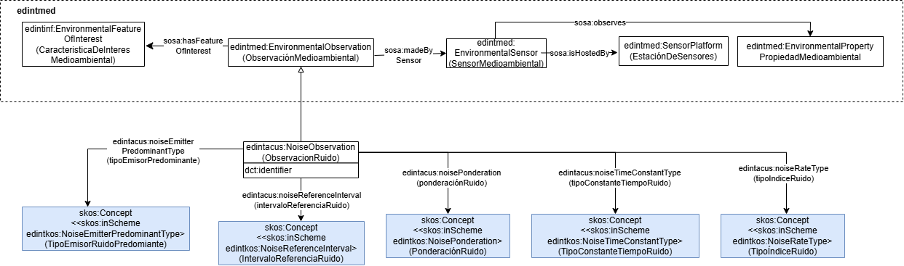
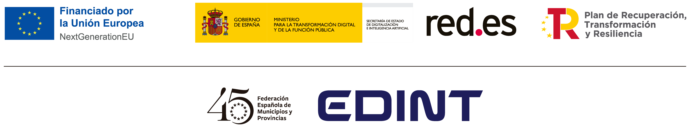

# Ontología EDINT de Contaminación Acústica

Este repositorio contiene la extensión de la ontología de Sensores Medioambientales para el caso de contaminación acústica.

Ver también: [Ontología EDINT de Sensores Medioambientales](https://github.com/EDINT-Ontologia/edint-ontologia-medio-ambiente)

## Propósito y alcance de la ontología (Purpose and scope of the ontology)

La ontología de Sensores Medioambientales ha sufrido una pequeña ampliación para reflejar los aspectos específicos de las observaciones de ruido.

## Prefijo y espacio de nombres (Prefix and namespace)

El prefijo de esta ontología es `edintacus` y se publica bajo el espacio de nombres https://edint.es/def/contaminacion-acustica#

## Modelo conceptual (Ontology conceptualization)

## Estructura del repositorio (Repository structure)

| Carpeta | Descripción |
|--------|--------------|
| **diagrams/**     | Almacena diagramas y otros recursos que representan el modelo conceptual de la ontología (por ejemplo, jerarquías de clases, relaciones).                                     |
| **documentation/**         | Almacena la documentación HTML u orientada a humanos de la ontología y artefactos relacionados.                                                                               |
| **examples/**     | Incluye ejemplos que demuestran cómo instanciar o aplicar la ontología en escenarios de datos reales.                                                                         |
| **kos/**          | Almacena vocabularios controlados o implementación de KOS, generalmente implementaciones SKOS en RDF.                                                                         |
| **ontology/**     | Contiene los archivos de implementación reales de la ontología en formatos como `.owl`, `.rdf`, `.ttl` o `.jsonld`.                                                           |
| **requirements/** | Contiene todos los documentos utilizados para definir los requisitos de la ontología: ejemplos de datos, preguntas de competencia, requisitos funcionales, casos de uso, etc. |
| **shapes/**       | Contiene los SHACL shapes utilizadas para definir y validar las restricciones de la ontología.                                                                                |

## Relación con ontologías anteriores (Relationship with previous ontologies)

Esta ontología sustituye a la ontología `http://vocab.ciudadesabiertas.es/def/medio-ambiente/contaminacion-acustica`, desarrollada en el proyecto OpenCityData y Ciudades Abiertas (repositorio [opencitydata/vocab-medio-ambiente-contaminacion-acustica](https://github.com/opencitydata/vocab-medio-ambiente-contaminacion-acustica) y [CiudadesAbiertas/vocab-medio-ambiente-contaminacion-acustica](https://github.com/CiudadesAbiertas/vocab-medio-ambiente-contaminacion-acustica)). La ontología anterior está deprecada: sus ficheros la marcan con `owl:deprecated` e indican, término a término, el término de esta ontología que lo sustituye (`dcterms:isReplacedBy`) o el más próximo (`rdfs:seeAlso`). Su URI se mantiene por compatibilidad, pero los datos nuevos deben usar esta ontología.

Las estaciones de medida y las observaciones genéricas que incluía la ontología anterior se modelan ahora en la [Ontología EDINT de Sensores Medioambientales](https://github.com/EDINT-Ontologia/edint-ontologia-medio-ambiente).

*This ontology supersedes the deprecated ontology `http://vocab.ciudadesabiertas.es/def/medio-ambiente/contaminacion-acustica`; the old one keeps its IRIs for backwards compatibility.*

## Mantenimiento y evolución (Maintenance and evolution)

Para manejar las incidencias o mejoras sugeridas con respecto a la ontología, recomendamos seguir las guías proporcionadas en ([Issues Management](./ISSUES.md)) para generar una incidencia.

## Financiación (Funding)

Esta ontología ha sido desarrollada en el contexto del Espacio de Datos para las Infraestructuras Urbanas Inteligentes ([EDINT](https://edint.es)).

